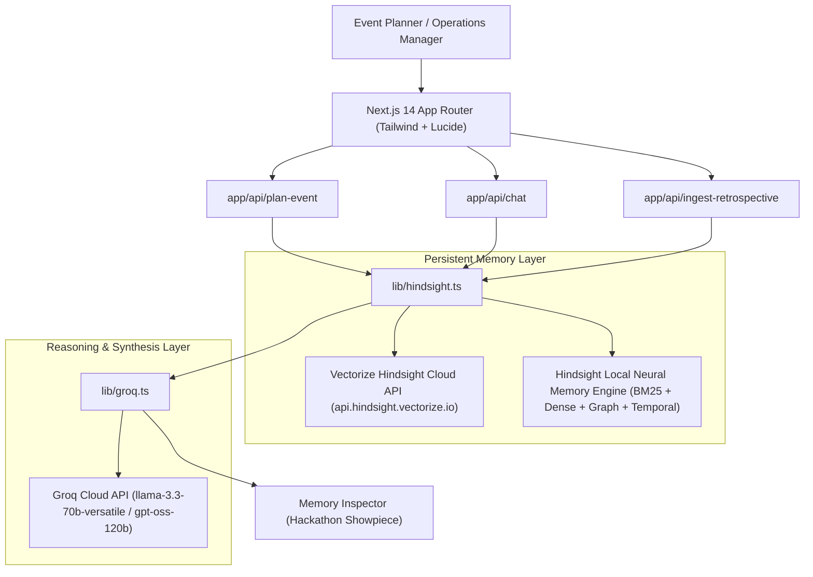

# RecallHQ (The Headquarters for Your Event Memory)
> **Built for HackwithHyderabad 3.0 Hackathon**
> Powered by **Vectorize Hindsight Persistent Memory** & **Groq High-Speed LLM Inference**

---

## 1. Executive Summary & Business Case

Corporate operations teams, enterprise event planners, and venue managers repeatedly make the same costly logistical mistakes because institutional venue history remains trapped in disconnected spreadsheets, post-event emails, and Slack threads.

**RecallHQ (featuring VenueIQ)** is an AI event-intelligence agent with persistent hindsight memory. It retains and recalls:
- **Past Venue Limitations:** e.g., unannounced freight elevator servicing at HICC Novotel that delays stage setup, or house soundboard acoustic feedback in T-Hub Auditorium 1 when attendance exceeds 300.
- **Date & Seasonal Constraints:** e.g., monsoon rainwater drainage failure on Cyber Pearl Open Lawn every mid-July through August, forcing moves to poorly ventilated basement halls.
- **Vendor & Demographic Disparities:** e.g., 20% vegetarian catering shortfalls at Hyderabad tech conferences when relying on standard hotel ratios, or valet saturation at ITC Kohenur by 6:30 PM due to concurrent ballroom bookings.
- **Predictive Checklists & Mitigation Protocols:** Synthesizes actionable checklists and mitigation plans with cited historical precedents before contracts are signed.

---

## 2. Key Architecture & Tech Stack



- **Frontend:** Next.js 14 (App Router), TypeScript, Tailwind CSS, Lucide icons, Glassmorphism UI.
- **Memory Engine:** Vectorize Hindsight API (`@vectorize-io/hindsight-client` and REST SDK protocol) with dual cloud and local hybrid engine supporting dense vector, BM25 keyword, temporal date/season, and graph traversal.
- **LLM Reasoning:** Groq API (`llama-3.3-70b-versatile`, `openai/gpt-oss-120b`, or `qwen/qwen3-32b`) strictly instructed to ground advice on recalled memories.
- **Database / Store:** Local JSON/SQLite persistent store (`lib/db.ts`) with seed dataset of 4 canonical Hyderabad venues and live retrospective submission.

---

## 3. Seeded Historical Precedent Scenarios (HackwithHyderabad)

RecallHQ is preloaded with realistic corporate event scenarios across Hyderabad:

1. **HICC Novotel, Hyderabad** *(15 July 2025 · Conference)*
   - **Incident:** Freight elevator delay caused 1-hour delay for stage setup; catering ran 20% short on vegetarian options during lunch peak.
   - **Hindsight Remedy:** Pre-reserve North service lift 48h prior with facility chief; bump vegetarian ratio to 65% for Hyderabad tech audiences.

2. **T-Hub Phase 2, Knowledge City** *(12 Nov 2025 · Hackathon)*
   - **Incident:** AV mic feedback in Auditorium 1 when over 300 guests attend; Wi-Fi 2.4GHz interference with roving microphones.
   - **Hindsight Remedy:** Contract third-party audio engineer with hardware DSP feedback suppressors; isolate wireless mics to UHF/DECT spectrum.

3. **Cyber Pearl Open Lawn, HITEC City** *(20 Aug 2025 · Meetup)*
   - **Incident:** Monsoon rain waterlogged the lawn within 20 minutes; emergency move to Basement 2 caused HVAC failure and zero cellular reception across Airtel/Jio.
   - **Hindsight Remedy:** Enforce indoor dry ballroom fallback contract for July–September; install temporary cellular repeaters and pedestal fans if using Basement 2.

4. **ITC Kohenur, Durgam Cheruvu** *(10 Jan 2026 · Executive Dinner)*
   - **Incident:** Valet parking reached 100% capacity by 6:30 PM due to concurrent Grand Ballroom weddings, creating a 30-minute gridlock on Inorbit road.
   - **Hindsight Remedy:** Cross-verify concurrent hotel bookings 5 days early; pre-contract Mindspace overflow lot with electric golf cart shuttles.

---

## 4. Getting Started & Setup Instructions

### Prerequisites
- Node.js 18+ (tested on Node v20/v24)
- npm or pnpm

### Step 1: Clone and Install
```bash
git clone https://github.com/your-username/RecallHQ.git
cd RecallHQ
npm install
```

### Step 2: Configure Environment Variables
Copy `.env.local.example` to `.env.local`:
```bash
cp .env.local.example .env.local
```

Edit `.env.local`:
```env
# Vectorize Hindsight API Key & Bank ID
# (Get yours at https://hindsight.vectorize.io/)
HINDSIGHT_API_KEY=your_hindsight_api_key_here
HINDSIGHT_API_URL=https://api.hindsight.vectorize.io
HINDSIGHT_BANK_ID=recallhq_production_events

# Groq API Configuration
# (Get yours at https://console.groq.com/)
GROQ_API_KEY=your_groq_api_key_here
GROQ_MODEL=llama-3.3-70b-versatile
```

> **Note on Zero-Configuration Demo Mode:**
> If API keys are omitted or offline during judging, RecallHQ automatically activates its built-in **Hindsight Neural Memory Engine** with deterministic semantic grounding. It simulates identical RRF fused scores, graph nodes, and confidence metrics so the entire application and showpiece memory inspector work 100% reliably out of the box!

### Step 3: Run Development Server
```bash
npm run dev
```
Open [http://localhost:3000](http://localhost:3000) in your browser.

### Step 4: Build for Production
```bash
npm run build
npm run start
```

---

## 5. Walkthrough of Hackathon Showpieces

1. **Contextual Event Planner & Quick Presets:**
   - Click any Hyderabad preset (e.g. *"Cyber Pearl Meetup (Monsoon/Oct)"* or *"T-Hub Hackathon (Winter/Nov)"*).
   - Click **Generate Intelligent Venue Briefing with Hindsight**.
   - Watch the agent query Hindsight memory and deliver an actionable briefing with past failure modes, learned remedies, and a predictive checklist.

2. **Memory Inspector Demo Panel (The Hackathon Showpiece):**
   - Click the **Memory Inspector** tab.
   - **Dual-Panel View:** View side-by-side what a generic stateless LLM outputs (*"check catering, arrange parking"*) vs. VenueIQ with Hindsight memory (*"North freight lift maintenance lockout", "Auditorium 1 mic howling past 300 guests"*).
   - **Hindsight Trace Nodes:** Inspect the granular facts, experiences, observations, and opinions retrieved via Reciprocal Rank Fusion (RRF).
   - **Raw Telemetry:** View vector similarity scores, confidence percentages, and retrieval latency.

3. **Retrospective Ingestion (Learning Loop):**
   - Click the **Memory Bank & Retrospectives** tab.
   - Click **Ingest Retrospective** to log a new completed event with observed failure modes.
   - Watch the retrospective immediately get tagged and embedded into the Hindsight memory graph.

4. **Interactive Memory Q&A Agent:**
   - Click the **Interactive Q&A Agent** tab.
   - Ask: *"What issues did we face last time we hosted in Hyderabad during October?"*
   - Toggle **Show Stateless Comparison** to see the stark contrast between stateless hallucination and grounded memory recall.

5. **Seasonal & Environmental Heatmap:**
   - Inspect seasonal hazards across Hyderabad (Monsoon rainfall risks, Winter wedding valet peaks, Tech vegetarian ratios).

---

## 6. Directory Structure
```
RecallHQ/
├── app/
│   ├── api/
│   │   ├── chat/route.ts                # Interactive Q&A memory endpoint
│   │   ├── events/route.ts              # Database CRUD & reset endpoint
│   │   ├── hindsight/route.ts           # Hindsight engine status & node inspector
│   │   ├── ingest-retrospective/route.ts# Ingestion & retention endpoint
│   │   └── plan-event/route.ts          # Pipeline orchestrating recall -> LLM briefing
│   ├── globals.css                      # Tailwind styling & dark glassmorphism
│   ├── layout.tsx                       # Root layout & metadata
│   └── page.tsx                         # Main enterprise dashboard with tab navigation
├── components/
│   ├── EventPlannerForm.tsx             # Interactive planner with Hyderabad presets
│   ├── InteractiveChat.tsx              # Natural language memory Q&A with dual view
│   ├── MemoryInspector.tsx              # Hackathon showpiece dual-panel & node tracer
│   ├── Navbar.tsx                       # Top bar with engine config & live status badges
│   ├── PastEventsTable.tsx              # Retrospectives table & ingestion modal
│   ├── TimelineCalendar.tsx             # Seasonal risk heatmap & memory badges
│   └── VenueBriefingCard.tsx            # Synthesized briefing card with checklists
├── lib/
│   ├── db.ts                            # Persistent storage & seed scenarios
│   ├── groq.ts                          # Groq API client with strict grounding templates
│   ├── hindsight.ts                     # Vectorize Hindsight wrapper (retain & recall)
│   └── utils.ts                         # Formatting & season calculation utilities
├── types/
│   └── index.ts                         # Comprehensive TypeScript interfaces
├── .env.local.example                   # Environment configuration template
├── package.json                         # Dependencies & build scripts
└── tsconfig.json                        # TypeScript configuration
```

---

## 7. License
Developed for HackwithHyderabad 3.0. MIT License.
